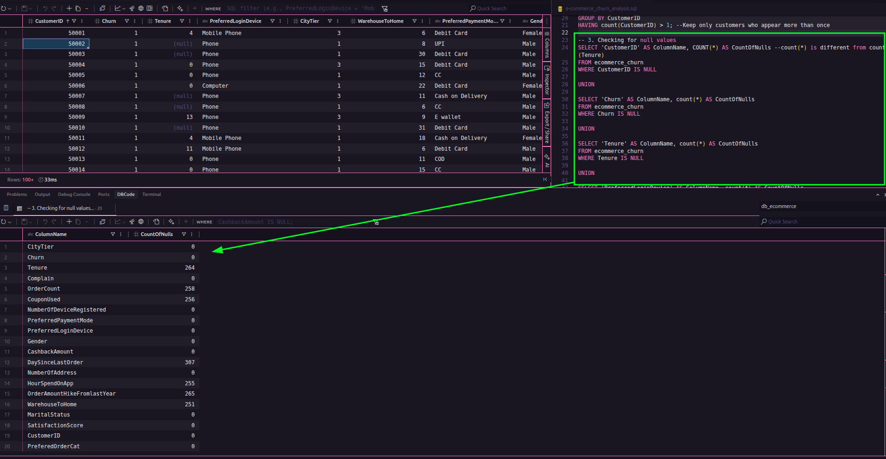
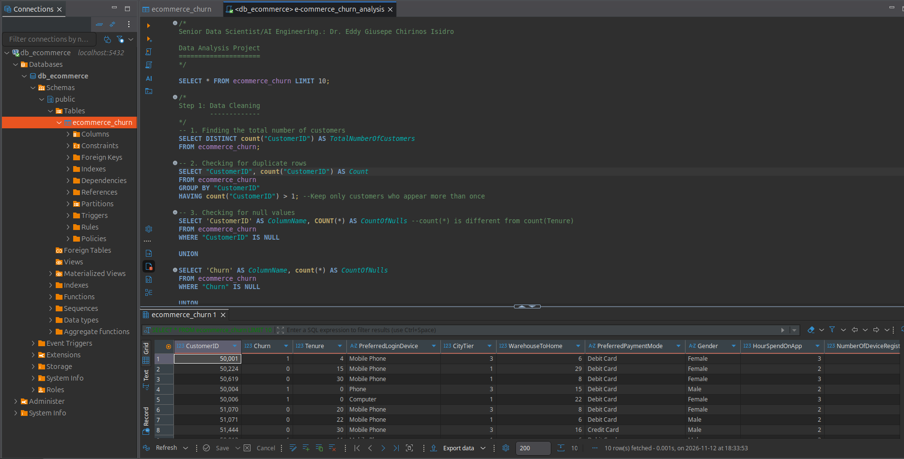

<h1 align="center"><font color="gree">E-commerce Customer Churn Analysis using SQL</font></h1>

<font color="pink">Senior Data Scientist/AI Engineering.: Dr. Eddy Giusepe Chirinos Isidro</font>


E-commerce churn analysis project using SQL to explore data, calculate retention metrics, segment customers, and identify patterns associated with customer loss.

## <font color="red">Using DBCode</font>
We use an extension in VS Code called DBCode to perform analysis using SQL.




## <font color="red">Running PostgreSQL with Docker Compose</font>

The `docker-compose.yml` file provides a ready-to-use PostgreSQL 17 instance, so there is
no need to install a database server on your machine. Data is kept in a named volume
(`pgdata`), which survives container restarts.

```bash
docker compose up -d
```

The container `churn-postgres` starts listening on `localhost:5432` with these defaults:

| Variable | Default | Description |
|---|---|---|
| `POSTGRES_DB` | `db_ecommerce` | Database name |
| `POSTGRES_USER` | `churn` | Database user |
| `POSTGRES_PASSWORD` | `churn` | Password (local development only) |
| `POSTGRES_PORT` | `5432` | Host port mapped to the container |
| `TZ` | `UTC` | Timezone, keeps dates predictable |

Every value can be overridden with a `VAR=value` prefix or through a `.env` file in the
project root (already ignored by Git). The container exposes a `healthcheck`, so you can
confirm it is ready with `docker compose ps` — the state should show `healthy`.

Connection settings for DBeaver, DBCode or any other SQL client:

| Field | Value |
|---|---|
| Host | `localhost` |
| Port | `5432` |
| Database | `db_ecommerce` |
| User | `churn` |
| Password | `churn` |

Useful day-to-day commands:

```bash
docker compose ps                      # container status and health
docker compose logs -f postgres        # follow the server logs
docker compose exec postgres psql -U churn -d db_ecommerce   # open a psql session
docker compose stop                    # stop, keeping the data
docker compose down                    # remove the container, keeping the volume
docker compose down -v                 # remove the container AND delete all data
```

> **Note:** the compose file only provisions the server. The `ecommerce_churn` table is
> **not** created automatically — import your dataset first, then run the analysis:
>
> ```bash
> docker compose exec -T postgres psql -U churn -d db_ecommerce < e-commerce_churn_analysis.sql
> ```


## <font color="red">Using PostgreSQL</font>
We also used PostgreSQL within DBeaver to carry out this data analysis project using SQL.




Study links:

* [KD nuggets](https://www.kdnuggets.com/5-real-world-sql-projects-to-build-your-data-portfolio)

* [Medium](https://medium.com/@okon.judith/e-commerce-customer-churn-analysis-using-sql-a34a95c4a367)


Thanks God!